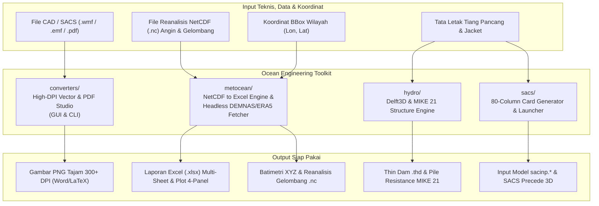

# Ocean Engineering Toolkit

[](https://github.com/Asikraam/ocean-engineering-toolkit/archive/refs/heads/main.zip)
[](https://www.python.org/)
[](LICENSE)
[](https://github.com/Asikraam/ocean-engineering-toolkit)

Kumpulan skrip dan modul automasi Python praktis untuk menunjang pekerjaan **Ocean, Coastal, and Offshore Engineering**. Didesain untuk mempercepat alur kerja harian: dari konversi gambar grafik teknis resolusi tinggi, ekstraksi data NetCDF ke Excel terformat, penarikan data batimetri/metocean tanpa browser, hingga generator model struktur Bentley SACS dan pemodelan numerik Delft3D / MIKE 21.

> [!TIP]
> **Tidak punya akun GitHub?** Kamu tidak perlu login sama sekali. Cukup klik tombol hijau **[Download ZIP Source Code](https://github.com/Asikraam/ocean-engineering-toolkit/archive/refs/heads/main.zip)** di atas untuk langsung mengunduh seluruh file ke komputermu.

---

## 🗺️ Alur Kerja & Arsitektur Modul



---

## 📥 Panduan Unduh & Akses (Untuk Semua Orang)

Repositori ini bersifat **100% Publik**. Siapapun di seluruh dunia bisa mengakses dan menyalin kodenya secara bebas tanpa perlu login:

### Cara 1: Unduh Langsung via Browser (Tanpa Akun GitHub)
1. Klik tombol **[Download ZIP](https://github.com/Asikraam/ocean-engineering-toolkit/archive/refs/heads/main.zip)** di bagian atas halaman ini (atau klik tombol hijau `<> Code` di kanan atas lalu pilih **Download ZIP**).
2. Ekstrak file zip di komputermu.
3. Seluruh skrip Python langsung siap dijalankan!

### Cara 2: Clone via Terminal (Untuk Pengguna Git)
```bash
git clone https://github.com/Asikraam/ocean-engineering-toolkit.git
cd ocean-engineering-toolkit
pip install -r requirements.txt
```

---

## ⚡ Quick Start: Perintah yang Sering Digunakan

Semua fungsi dapat dipanggil langsung melalui antarmuka perintah terpadu `cli.py`:

```bash
# 1. Buka Universal Converter Desktop Studio (WMF/EMF Vector & Multi-page PDF)
python cli.py converter-gui

# 2. Buka Metocean NetCDF to Excel Converter GUI (lengkap dengan grafik preview 4-panel)
python cli.py nc2excel-gui

# 3. Ekstrak NetCDF Angin & Gelombang langsung ke Excel via CLI (Headless)
python cli.py nc2excel --meteo-dir ./data/Meteo_ERA5 --wave-dir ./data/Wave_Marine --lat -8.00 --lon 131.25 -o Metocean_Report.xlsx

# 4. Ubah grafik plot SACS/Precede (.wmf) jadi PNG tajam 300 DPI untuk laporan
python cli.py wmf2png gambar_sacs.wmf --dpi 300

# 5. Download tile batimetri DEMNAS otomatis via koordinat tanpa buka Chrome
python cli.py demnas --bbox 106.6 -6.1 107.0 -5.8

# 6. Hitung susunan tiang pancang & koefisien hambatan Delft3D FLOW
python cli.py delft-pile --nx 4 --ny 6 --dx 5.0 --dy 5.0 --dia 1.2

# 7. Generate kartu SACS 3-Leg Tripod Jacket otomatis
python cli.py sacs-tripod --depth 45.0 --airgap 12.0
```

---

## 📚 Rincian Modul & Cara Pakai Lengkap

### 1. Document & Graphic Converters Suite (`converters/`)
Mengatasi masalah klasik grafik buram saat mengekspor visualisasi dari Bentley SACS / Precede ke dokumen Microsoft Word atau LaTeX:
- **`UniversalConverterApp.py`**: Aplikasi GUI modern berantarmuka ganda (Dual Tab) untuk konversi vektor WMF/EMF Ultra-HD dan dokumen PDF beresolusi tinggi dengan dukungan tema gelap/terang otomatis.
- **`PdfToPngTurboApp.py`**: Aplikasi GUI multi-threaded untuk rasterisasi PDF cepat, pemilihan rentang halaman (`1, 3-5, 10`), dan kontrol resolusi (150/300/600 DPI).
- **`WmfToPngConverterApp.py`**: Aplikasi GUI khusus konversi vektor WMF/EMF dengan fitur transparansi background dan padding pixel.
- **`wmf_converter.py` & `pdf_converter.py`**: Mesin rasterisasi backend berbasis Windows Native GDI+ dan PDFium.

```bash
# Jalankan aplikasi Desktop GUI terpadu:
python cli.py converter-gui

# Atau jalankan konversi batch via CLI:
python cli.py wmf2png ./folder_grafik_sacs/ --dpi 300
```

---

### 2. Metocean & Data Processing Suite (`metocean/`)
Mengambil data oseanografi dan elevasi langsung ke disk serta mengonversi format NetCDF reanalisis ke laporan tabular profesional:
- **`MetoceanNcToExcelApp.py`**: Aplikasi desktop GUI interaktif untuk memilih titik koordinat, mengekstrak data angin (ERA5) dan gelombang spektral (Copernicus Marine), serta menampilkan grafik preview 4-panel (kecepatan angin, arah angin, $H_s$, $T_p$).
- **`MetoceanNcToExcelEngine.py`**: Mesin CLI headless untuk memproses dataset NetCDF ke laporan Microsoft Excel (`.xlsx`) multi-sheet terformat rapi (Ringkasan Statistik, Data Gabungan, Angin ERA5, Gelombang Marine) lengkap dengan styling OpenPyXL, zebra striping, dan freeze panes.
- **`demnas.py`**: Menghitung Nomor Lembar Peta (NLP skala 1:50.000) berdasarkan bounding box koordinat geodetik, mengunduh tile DEMNAS secara *headless*, dan mengekspornya ke format ASCII XYZ (`.xyz`) untuk mesh pemodelan.
- **`ecmwf_era5.py`**: Menghubungkan script ke Copernicus Climate Data Store (CDS API) untuk menarik data historis tinggi gelombang signifikan ($H_s$), periode ($T_p$), arah gelombang, dan angin 10 meter ($u_{10}, v_{10}$) dalam format NetCDF (`.nc`).

```bash
# Jalankan GUI Metocean NetCDF to Excel:
python cli.py nc2excel-gui

# Ekstraksi NetCDF ke Excel via CLI:
python cli.py nc2excel --meteo-dir ./data/Meteo_ERA5 --wave-dir ./data/Wave_Marine --lat -8.00 --lon 131.25 -o Laporan_Metocean.xlsx
```

---

### 3. Hydrodynamic Modeling Helper (`hydro/`)
Otomasi definisi batas struktur penghalang untuk software pemodelan hidrodinamika pantai:
- **`delft3d_pile.py`**: Menghitung koefisien rugi-daya (*quadratic energy loss coefficient*, $c_{loss}$) untuk barisan tiang pancang (dermaga/jacket) yang direpresentasikan sebagai *porous plate* di Delft3D FLOW, serta membuat file *thin dam* (`.thd`).
- **`mike21_pile.py`**: Menghasilkan file spesifikasi tahanan tiang pancang ASCII untuk modul DHI MIKE 21 HD FM.

```bash
# Format pemakaian untuk konfigurasi 4x6 tiang:
python cli.py delft-pile --nx 4 --ny 6 --dx 5.0 --dy 5.0 --dia 1.2 -o piles.csv
```

---

### 4. SACS Offshore Automation (`sacs/`)
Otomasi pra-proses analisis struktur lepas pantai:
- **`cards.py`**: Generator kartu 80-kolom fixed-format (`JOINT`, `MEMBER`, `SECT`, `PGRP`) standar SACS 2025.
- **`runner.py`**: Menjalankan Bentley SACS Executive dan membuka Precede 3D modeler secara aman tanpa risiko auto-close.

```bash
# Buka SACS Precede langsung dari terminal:
python cli.py sacs-precede
```

---

## 📂 Struktur Repositori

```
ocean-engineering-toolkit/
├── converters/               # Modul & Desktop GUI konversi grafis & dokumen
│   ├── UniversalConverterApp.py   # Flagship 2-in-1 Vector & PDF Studio GUI
│   ├── PdfToPngTurboApp.py        # Turbo Multi-threaded PDF Rasterizer GUI
│   ├── WmfToPngConverterApp.py    # Dedicated WMF/EMF Vector Converter GUI
│   ├── ConvertWmfToPng.ps1        # Windows GDI+ PowerShell backend
│   ├── wmf_converter.py           # Backend engine WMF GDI+
│   └── pdf_converter.py           # Backend engine PDFium
├── metocean/                 # Modul pengolahan NetCDF & penarikan data geospasial
│   ├── MetoceanNcToExcelApp.py    # Interactive GUI NetCDF to Excel + 4-panel preview
│   ├── MetoceanNcToExcelEngine.py # Headless CLI engine NetCDF to Excel
│   ├── demnas.py                  # Headless Indonesian DEMNAS fetcher
│   └── ecmwf_era5.py              # CDS API automated ERA5 fetcher
├── hydro/                    # Modul struktur tiang Delft3D & MIKE 21
│   ├── delft3d_pile.py
│   └── mike21_pile.py
├── sacs/                     # Modul kartu SACS & runner
│   ├── cards.py
│   └── runner.py
├── examples/                 # Contoh file input & hasil tes
├── cli.py                    # Antarmuka CLI utama terpadu
├── requirements.txt          # Daftar dependencies Python
├── LICENSE                   # Lisensi open-source MIT
└── README.md                 # Dokumentasi proyek
```

---

## 👨‍💻 Author
Dikembangkan oleh **Aswal Ikraam Aritonang**  
GitHub: [@Asikraam](https://github.com/Asikraam)  
Email: [aswal.space@gmail.com](mailto:aswal.space@gmail.com)

---

## 📄 Lisensi

Didistribusikan di bawah Lisensi MIT. Siapapun bebas menggunakan, menyalin, dan memodifikasi untuk keperluan riset maupun pekerjaan profesional. Lihat file [LICENSE](LICENSE) untuk ketentuan lengkap.
