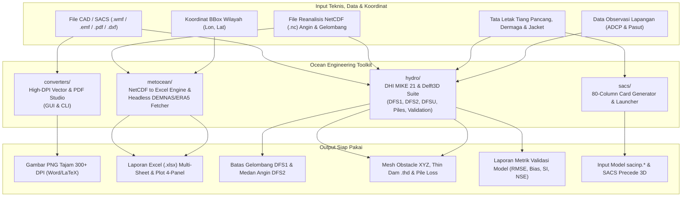

# Ocean Engineering Toolkit

[](https://github.com/Asikraam/ocean-engineering-toolkit/archive/refs/heads/main.zip)
[](https://www.python.org/)
[](LICENSE)
[](https://github.com/Asikraam/ocean-engineering-toolkit)

Kumpulan skrip dan modul automasi Python praktis untuk menunjang pekerjaan **Ocean, Coastal, and Offshore Engineering**. Didesain untuk mempercepat alur kerja harian: dari konversi gambar grafik teknis resolusi tinggi, ekstraksi data NetCDF ke Excel terformat, pemodelan numerik pantai tingkat lanjut (**DHI MIKE 21 & Delft3D**), hingga generator model struktur Bentley SACS.

> [!TIP]
> **Tidak punya akun GitHub?** Kamu tidak perlu login sama sekali. Cukup klik tombol hijau **[Download ZIP Source Code](https://github.com/Asikraam/ocean-engineering-toolkit/archive/refs/heads/main.zip)** di atas untuk langsung mengunduh seluruh file ke komputermu.

---

## 🗺️ Alur Kerja & Arsitektur Modul



---

## 📥 Panduan Unduh & Akses (Untuk Semua Orang)

Repositori ini bersifat **100% Publik**. Siapapun di seluruh dunia bisa mengakses dan menyalin kodenya secara bebas tanpa perlu login:

### Cara 1: Unduh Langsung via Browser (Tanpa Akun GitHub)
1. Klik tombol **[Download ZIP](https://github.com/Asikraam/ocean-engineering-toolkit/archive/refs/heads/main.zip)** di bagian atas halaman ini (atau klik tombol hijau `<> Code` di kanan atas lalu pilih **Download ZIP**).
2. Ekstrak file zip di komputermu.
3. Seluruh skrip Python langsung siap dijalankan!

### Cara 2: Clone via Terminal (Untuk Pengguna Git)
```bash
git clone https://github.com/Asikraam/ocean-engineering-toolkit.git
cd ocean-engineering-toolkit
pip install -r requirements.txt
```

---

## ⚡ Quick Start: Perintah yang Sering Digunakan

Semua fungsi dapat dipanggil langsung melalui antarmuka perintah terpadu `cli.py`:

```bash
# 1. Buka Universal Converter Desktop Studio (WMF/EMF Vector & Multi-page PDF)
python cli.py converter-gui

# 2. Buka Metocean NetCDF to Excel Converter GUI (lengkap dengan grafik preview 4-panel)
python cli.py nc2excel-gui

# 3. Ekstrak NetCDF Angin & Gelombang langsung ke Excel via CLI (Headless)
python cli.py nc2excel --meteo-dir ./data/Meteo_ERA5 --wave-dir ./data/Wave_Marine --lat -8.00 --lon 131.25 -o Metocean_Report.xlsx

# 4. Buka Generator Kondisi Batas Gelombang MIKE 21 SW (NetCDF -> DFS1)
python cli.py mike-wave-dfs1

# 5. Buka Generator Medan Gaya Angin 2D Spasial MIKE 21 HD/SW (NetCDF -> DFS2)
python cli.py mike-wind-dfs2

# 6. Buka Generator Tiang Pancang & Trestle Obstacle MIKE 21 GUI
python cli.py mike-pile-gui

# 7. Konversi Garis/Polyline Gambar AutoCAD (.dxf) ke Batas MIKE (.xyz)
python cli.py dxf2xyz --input layout_dermaga.dxf -o boundary_dermaga.xyz

# 8. Gabungkan beberapa file simulasi MIKE 21 (.dfsu) yang terpotong menjadi 1 file utuh
python cli.py dfsu-concat --input-files part1.dfsu part2.dfsu -o simulasi_full.dfsu

# 9. Download tile batimetri DEMNAS otomatis via koordinat tanpa buka Chrome
python cli.py demnas --bbox 106.6 -6.1 107.0 -5.8

# 10. Generate kartu SACS 3-Leg Tripod Jacket otomatis
python cli.py sacs-tripod --depth 45.0 --airgap 12.0
```

---

## 📚 Rincian Modul & Cara Pakai Lengkap

### 1. DHI MIKE 21 & Hydrodynamic Modeling Suite (`hydro/`)
Otomasi komprehensif untuk pemodelan numerik hidrodinamika pantai, gelombang spektral, dan transpor sedimen:
* **`MikeConvertWaveDfs1App.py`**: Aplikasi GUI interaktif untuk membuat file kondisi batas gelombang spektral (`.dfs1`) dari NetCDF (ERA5 / Copernicus). Otomatis mendeteksi open boundary mesh code dan mengurutkan titik simpul secara *Counter-Clockwise* (CCW) wajib MIKE 21 SW.
* **`MikeConvertWindDfs2App.py`**: Aplikasi GUI untuk membuat medan gaya angin dan tekanan 2D (`.dfs2`) dengan fitur penggabungan 12 bulan dan *Auto-Detect UTM Zone*.
* **`MikePileGeneratorApp.py` & `MikeInsertPilesUniversal.py`**: Generator penempatan tiang pancang (*pile*), trestle, dan jetty head ke dalam mesh fleksibel MIKE 21. Otomatis merotasi kotak boundary mengikuti sudut orientasi struktur dengan kode konektivitas standar DHI (`1, 1, 1, 1, 0`).
* **`MikeExtractSedimentData.py`**: Ekstraksi time-series elevasi dasar laut (*bed level change*) dan laju sedimen dari mesh fleksibel DFSU per elemen.
* **`MikeMergeDfsu.py`**: Utilitas penggabungan deret waktu beberapa file DFSU menggunakan engine `mikeio.generic.concat()`.
* **`HydroModelValidation.py`**: Modul evaluasi performa model numerik terhadap data observasi lapangan (menghitung RMSE, Bias, Scatter Index, Pearson $R$, $R^2$, dan Nash-Sutcliffe Efficiency/NSE).
* **`CadDxfToXyz.py` & `QgisShpToMikeXyz.py`**: Konverter entitas AutoCAD DXF dan shapefile QGIS ke format teks batimetri & boundary MIKE Zero (`.xyz`).
* **`delft3d_pile.py` & `mike21_pile.py`**: Kalkulator koefisien rugi-daya (*porous plate energy loss* $c_{loss}$) Delft3D FLOW dan spesifikasi tahanan tiang ASCII MIKE 21 HD.

---

### 2. Document & Graphic Converters Suite (`converters/`)
Mengatasi masalah klasik grafik buram saat mengekspor visualisasi dari Bentley SACS / Precede ke dokumen Microsoft Word atau LaTeX:
* **`UniversalConverterApp.py`**: Aplikasi GUI modern berantarmuka ganda (Dual Tab) untuk konversi vektor WMF/EMF Ultra-HD dan dokumen PDF beresolusi tinggi dengan dukungan tema gelap/terang otomatis.
* **`PdfToPngTurboApp.py`**: Aplikasi GUI multi-threaded untuk rasterisasi PDF cepat, pemilihan rentang halaman (`1, 3-5, 10`), dan kontrol resolusi (150/300/600 DPI).
* **`WmfToPngConverterApp.py`**: Aplikasi GUI khusus konversi vektor WMF/EMF dengan fitur transparansi background dan padding pixel.
* **`wmf_converter.py` & `pdf_converter.py`**: Mesin rasterisasi backend berbasis Windows Native GDI+ dan PDFium.

---

### 3. Metocean & Data Processing Suite (`metocean/`)
Mengambil data oseanografi dan elevasi langsung ke disk serta mengonversi format NetCDF reanalisis ke laporan tabular profesional:
* **`MetoceanNcToExcelApp.py`**: Aplikasi desktop GUI interaktif untuk memilih titik koordinat, mengekstrak data angin (ERA5) dan gelombang spektral (Copernicus Marine), serta menampilkan grafik preview 4-panel (kecepatan angin, arah angin, $H_s$, $T_p$).
* **`MetoceanNcToExcelEngine.py`**: Mesin CLI headless untuk memproses dataset NetCDF ke laporan Microsoft Excel (`.xlsx`) multi-sheet terformat rapi lengkap dengan styling OpenPyXL, zebra striping, dan freeze panes.
* **`demnas.py`**: Menghitung Nomor Lembar Peta (NLP) koordinat geodetik, mengunduh tile DEMNAS secara *headless*, dan mengekspornya ke format ASCII XYZ (`.xyz`).
* **`ecmwf_era5.py`**: Menghubungkan script ke Copernicus Climate Data Store (CDS API) untuk menarik data historis tinggi gelombang dan angin 10m dalam format NetCDF.

---

### 4. SACS Offshore Automation (`sacs/`)
Otomasi pra-proses analisis struktur lepas pantai:
* **`cards.py`**: Generator kartu 80-kolom fixed-format (`JOINT`, `MEMBER`, `SECT`, `PGRP`) standar SACS 2025.
* **`runner.py`**: Menjalankan Bentley SACS Executive dan membuka Precede 3D modeler secara aman tanpa risiko auto-close.

---

## 📂 Struktur Repositori

```
ocean-engineering-toolkit/
├── converters/               # Modul & Desktop GUI konversi grafis & dokumen
│   ├── UniversalConverterApp.py   # Flagship 2-in-1 Vector & PDF Studio GUI
│   ├── PdfToPngTurboApp.py        # Turbo Multi-threaded PDF Rasterizer GUI
│   ├── WmfToPngConverterApp.py    # Dedicated WMF/EMF Vector Converter GUI
│   ├── ConvertWmfToPng.ps1        # Windows GDI+ PowerShell backend
│   ├── wmf_converter.py           # Backend engine WMF GDI+
│   └── pdf_converter.py           # Backend engine PDFium
├── metocean/                 # Modul pengolahan NetCDF & penarikan data geospasial
│   ├── MetoceanNcToExcelApp.py    # Interactive GUI NetCDF to Excel + 4-panel preview
│   ├── MetoceanNcToExcelEngine.py # Headless CLI engine NetCDF to Excel
│   ├── demnas.py                  # Headless Indonesian DEMNAS fetcher
│   └── ecmwf_era5.py              # CDS API automated ERA5 fetcher
├── hydro/                    # Modul DHI MIKE 21, Delft3D & CAD/GIS
│   ├── MikeConvertWaveDfs1App.py  # GUI generator wave boundary .dfs1
│   ├── MikeConvertWindDfs2App.py  # GUI generator wind forcing .dfs2
│   ├── MikePileGeneratorApp.py    # GUI generator pile obstacle .xyz
│   ├── MikeInsertPilesUniversal.py# Core engine auto-detect pile rotation
│   ├── MikeExtractSedimentData.py # Ekstraktor data sedimen DFSU
│   ├── MikeMergeDfsu.py           # Penggabung file DFSU temporal
│   ├── HydroModelValidation.py    # Mesin validasi error model vs observasi
│   ├── CadDxfToXyz.py             # Konverter AutoCAD DXF ke MIKE XYZ
│   ├── QgisShpToMikeXyz.py        # Konverter shapefile QGIS ke MIKE XYZ
│   ├── delft3d_pile.py            # Delft3D porous plate loss & thin dam
│   └── mike21_pile.py             # DHI MIKE 21 ASCII pile specification
├── sacs/                     # Modul kartu SACS & runner
│   ├── cards.py
│   └── runner.py
├── examples/                 # Contoh file input & hasil tes
├── cli.py                    # Antarmuka CLI utama terpadu (18 subcommands)
├── requirements.txt          # Daftar dependencies Python lengkap
├── LICENSE                   # Lisensi open-source MIT
└── README.md                 # Dokumentasi proyek berstandar open-source
```

---

## 👨‍💻 Author
Dikembangkan oleh **Aswal Ikraam Aritonang**  
GitHub: [@Asikraam](https://github.com/Asikraam)  
Email: [aswal.space@gmail.com](mailto:aswal.space@gmail.com)

---

## 📄 Lisensi

Didistribusikan di bawah Lisensi MIT. Siapapun bebas menggunakan, menyalin, dan memodifikasi untuk keperluan riset maupun pekerjaan profesional. Lihat file [LICENSE](LICENSE) untuk ketentuan lengkap.
